# Gerenciador AD

Aplicativo administrativo em **PowerShell 5.1 + Windows Forms** para operações do dia a dia no Active Directory (RSAT).

> **Versão limpa:** o aplicativo não contém referências a uma organização específica. Empresa, escritórios, departamentos, cargos, setores, domínio de e-mail e OUs podem ser configurados em tempo de execução e ficam salvos em `padroes.json`.

## Funcionalidades

- **Cadastro e padronização de usuários:** criar usuário ou buscar um existente e padronizar seus dados. A descrição segue `SETOR - Ticket NUMERO`, com suporte a cobertura: `SETOR - Final da Cobertura DATA - Ticket NUMERO`.
- **Reset e desbloqueio de senha:** gerar senha temporária, desbloquear e redefinir a conta, forçando a troca no próximo logon.
- **Consulta de acessos:** exibir nome, e-mail e grupos dos quais o usuário é membro.
- **Gerenciamento de grupos:** consultar, adicionar, remover, copiar (espelhar) e comparar grupos entre usuários.
- **Desativação de usuário:** desativar a conta, registrar histórico, remover grupos de permissão e mover o objeto para a OU de desativados.
- **Movimentação de máquinas:** validar e mover computadores em lote (caminho amigável ou DN).
- **Relatórios:** consultar dados por cargo, cobertura, usuários desativados, usuários ativos e inativos há mais de 90 dias.
- **Histórico de usuário:** visualizar o atributo `info` (observações) do AD mantendo rastreabilidade.
- **Alteração em massa:** padronizar cargo, departamento, escritório e empresa de vários usuários selecionados.
- **Central de inconsistências:** auditoria somente leitura para identificar cadastros incompletos e máquinas fora da OU padrão, com exportação para CSV.

## Requisitos

- Windows com **PowerShell 5.1** (Windows 10/11 ou Windows Server).
- **RSAT** com o módulo `ActiveDirectory` instalado.
- Credencial administrativa válida no domínio.

## Como executar

No PowerShell com permissões adequadas, execute:

```powershell
powershell -ExecutionPolicy Bypass -File Gerenciador-AD-Limpo.ps1
```

Ao abrir, informe no login seu usuário administrativo no formato `dominio\administrador`.

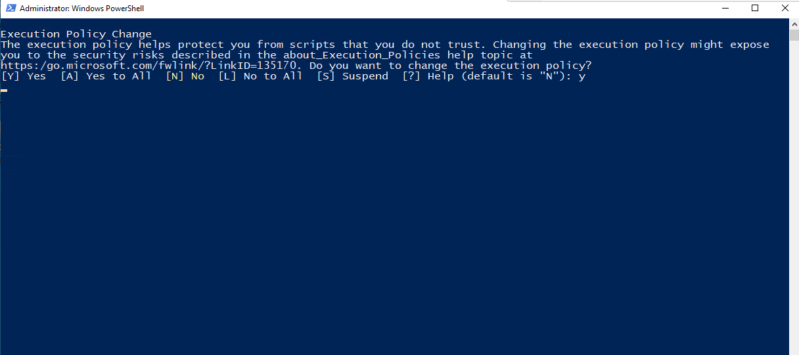

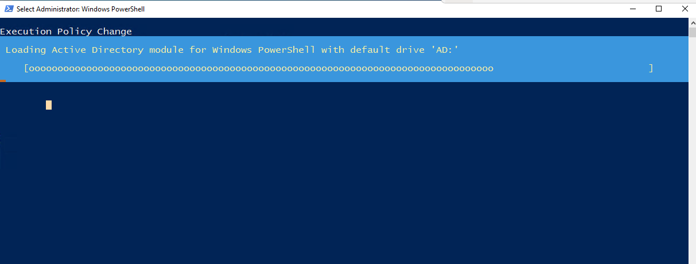

## Configuração inicial

No primeiro uso, o aplicativo cria automaticamente os parâmetros locais em:

```text
%APPDATA%\Gerenciador-AD\padroes.json
```

Ajuste os valores de exemplo para a estrutura da sua organização pelo menu **Valores padronizados** ou editando o arquivo JSON.

| Chave | Descrição | Exemplo |
| --- | --- | --- |
| `Empresas` | Empresas aceitas no cadastro | `["MINHA-EMPRESA"]` |
| `Escritorios` | Escritórios ou unidades | `["MATRIZ"]` |
| `Departamentos` | Departamentos corporativos | `["TI", "FINANCEIRO"]` |
| `Cargos` | Cargos válidos | `["Analista", "Coordenador"]` |
| `Setores` | Setores usados na descrição | `["TI", "RH"]` |
| `EmailDominio` | Sufixo para geração de UPN e e-mail | `"minhaempresa.com.br"` |
| `OUUsuarios` | DN da OU onde novos usuários são criados | `"OU=USUARIOS,DC=minhaempresa,DC=com,DC=br"` |

A OU de desativados é derivada de `OUUsuarios`, substituindo a primeira ocorrência de `OU=` por `OU=DESATIVADOS`. Crie essa OU no domínio se for utilizá-la.

## Guia das telas

As capturas abaixo documentam a interface disponível. Os rótulos podem variar entre versões; confirme os dados e o escopo antes de executar operações administrativas.

### Acesso e página inicial

Informe as credenciais administrativas no formato indicado pela aplicação. A página inicial apresenta a navegação e os pontos de entrada das rotinas.

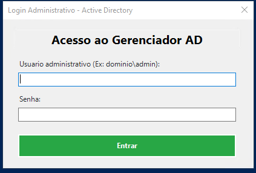

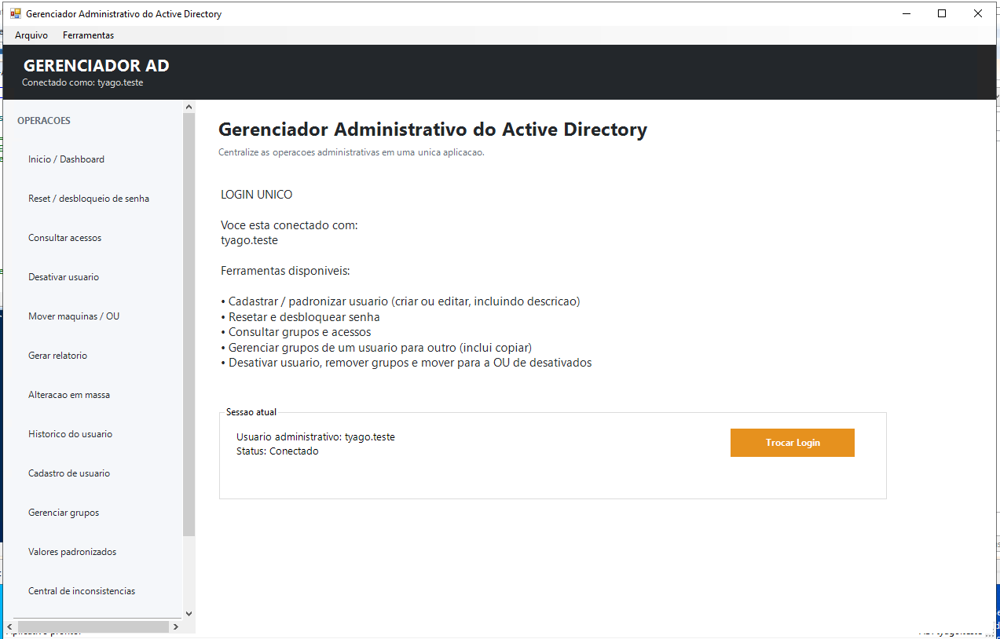

### Reset e desbloqueio de senha

Localize a conta, confira os dados e selecione o usuário correto antes de iniciar o reset ou desbloqueio.

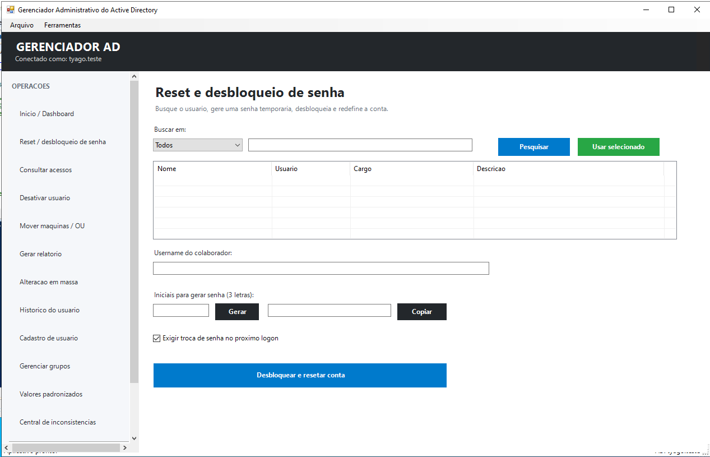

### Consulta de acessos

Pesquise o usuário para consultar seus dados e os grupos associados.

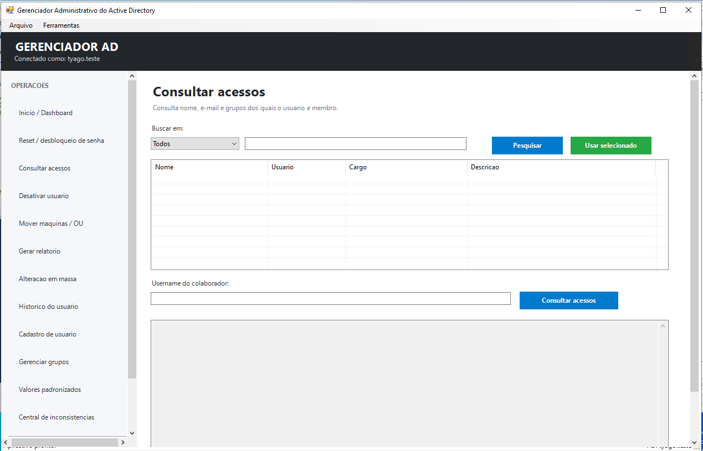

### Desativação de usuário

Pesquise e selecione a conta. Revise a identidade do usuário e confirme a autorização antes de desativar.

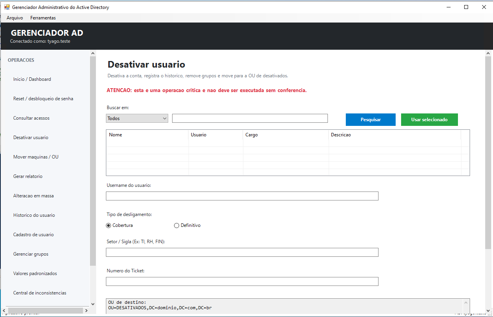

### Mover máquinas para uma OU

Informe ou localize os computadores e confira a origem, o destino e os itens selecionados antes de mover.

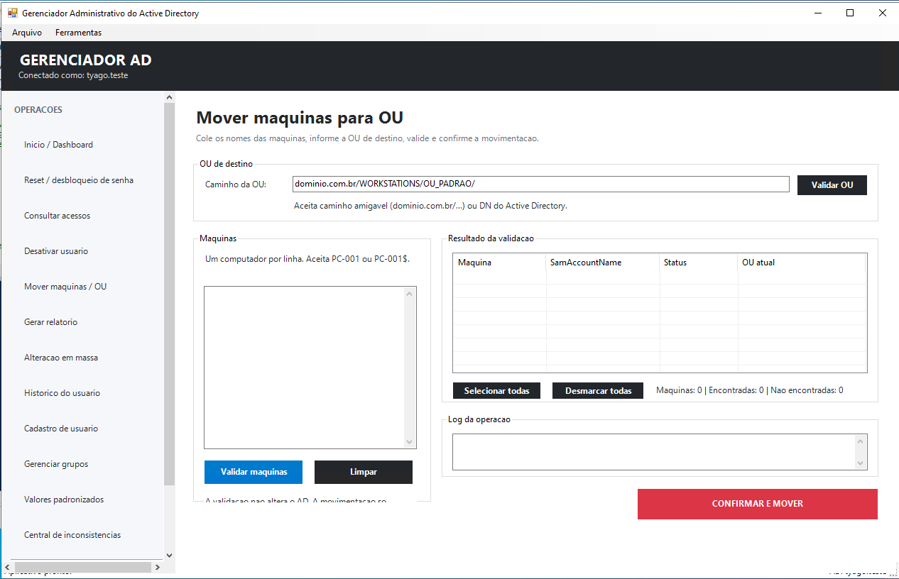

### Gerar relatório

Selecione os parâmetros disponíveis e solicite a geração do relatório. Os resultados são exibidos na área principal.

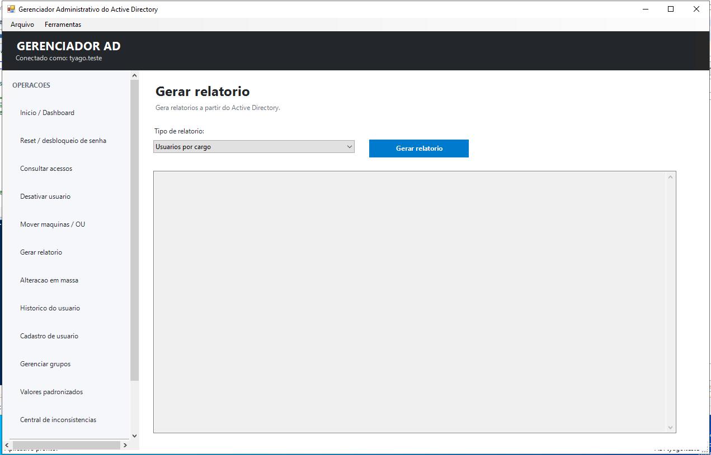

### Alteração em massa

Filtre e selecione as contas, confira os valores propostos e revise o conjunto selecionado antes de aplicar a alteração.

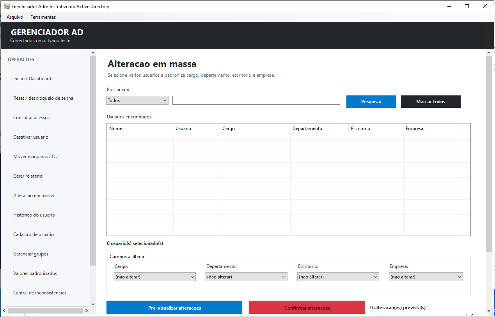

### Histórico do usuário

Pesquise uma conta para consultar os registros apresentados na tabela. O histórico detalhado é gravado no atributo `info` do objeto no Active Directory.

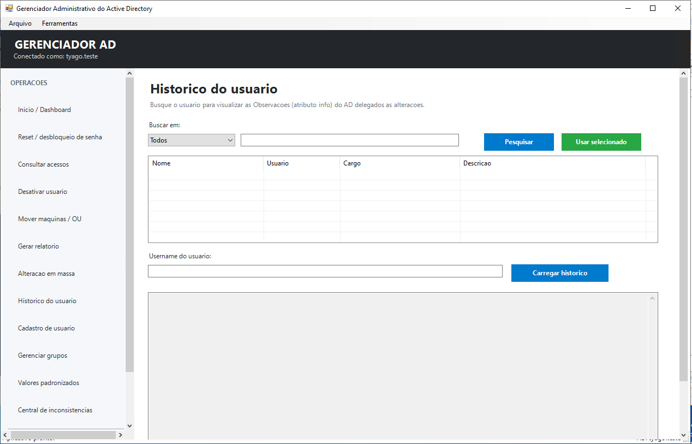

### Cadastro e padronização

Preencha os dados solicitados e revise-os antes de cadastrar ou padronizar o usuário.

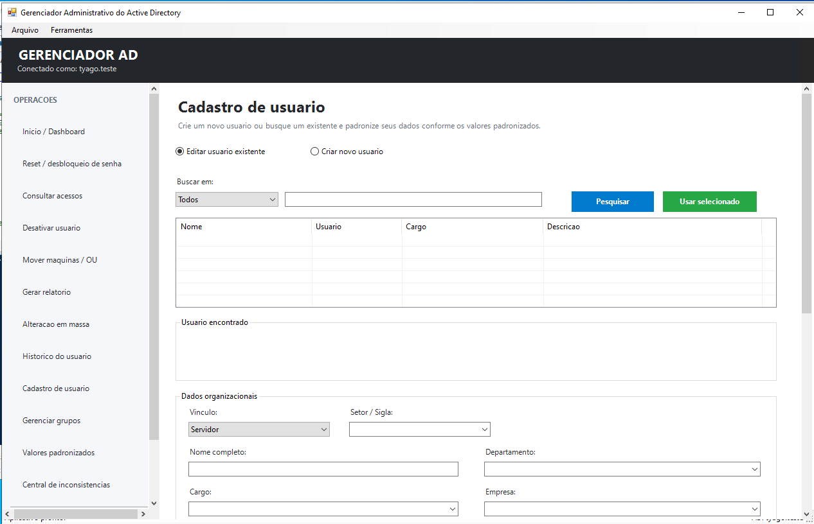

### Gerenciar grupos

Pesquise um grupo e utilize os controles da tela para consultar ou gerenciar associações. A tela também dá suporte a copiar e comparar grupos entre usuários.

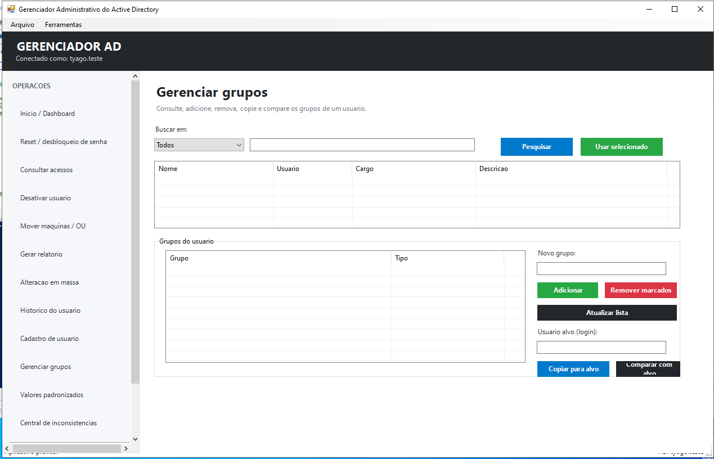
### Valores padronizados

Mantenha as listas de valores usadas nos cadastros e nas rotinas de padronização.

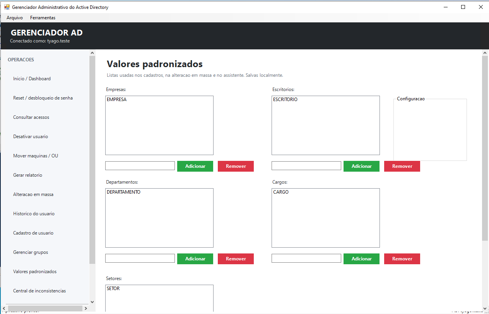

### Central de inconsistências

A central é uma auditoria somente leitura. Consulte as categorias e os resultados para identificar cadastros incompletos ou computadores fora da OU padrão.

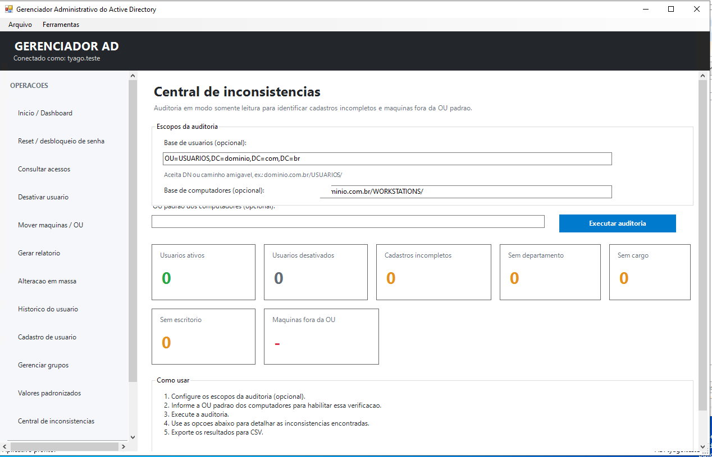

## Caminhos amigáveis e DN

Em **Mover máquinas** e na **Central de inconsistências**, os caminhos podem ser informados de duas formas:

1. **Caminho amigável:** `dominio.com.br/WORKSTATIONS/OU_DESTINO/`. O aplicativo converte o caminho para o formato do Active Directory.
2. **DN (Distinguished Name):** `OU=OU_DESTINO,OU=WORKSTATIONS,DC=dominio,DC=com,DC=br`.

## Segurança

- A credencial administrativa é solicitada uma vez no login e mantida somente em memória durante a execução.
- Ao fechar o aplicativo, a referência da credencial é descartada.
- Operações críticas, como desativação, remoção de grupos e alterações em massa, pedem confirmação explícita do operador.
- A Central de inconsistências é somente leitura.

## Observações

- Os textos da interface foram preparados para exibição no console Windows.
- O histórico das alterações efetuadas pelo painel é gravado no atributo `info` do objeto no Active Directory.
- As imagens deste guia estão em [`docs/images/gerenciador-ad`](docs/images/gerenciador-ad/), para que os links funcionem no GitHub.

## Licença

Projeto de uso interno, livre para adaptações em ambientes corporativos de infraestrutura de TI.
